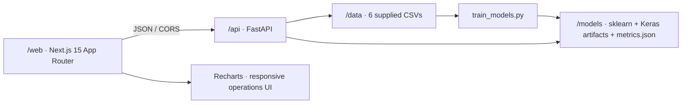

# Aegis Logistics — Real-Data Model Lab

Aegis is a responsive logistics operations site backed by six models trained from the six supplied CSV datasets. All quote, ETA, risk, failure, ticket-triage, and volume-forecast responses come from saved scikit-learn/Keras artifacts; model fitting is an explicit offline step, never a request-time fallback.

> **Decision-support demo only.** Held-out scores describe these supplied datasets, not a live delivery fleet. Inputs outside observed ranges are rejected where applicable. Do not use the estimates as actual prices, delivery commitments, staffing instructions, or customer/safety decisions.

## Stack and architecture

The web app uses Next.js App Router, TypeScript, Tailwind CSS, Recharts, and Lucide. The API is FastAPI/Pydantic. Training uses pandas, scikit-learn, and TensorFlow/Keras.



The requested Next.js 14 line has no release that clears the critical advisory reported by the package audit. This app therefore uses patched Next.js **15.5.28**, retaining the requested App Router, React 18, TypeScript, Tailwind, and page/component architecture rather than shipping a known-vulnerable Next 14 build.

## Run locally

Prerequisites: Python 3.12, Node.js 20+, and npm.

### 1. Train the six models

From the repository root, in PowerShell:

```powershell
py -3.12 -m venv .venv
.\.venv\Scripts\Activate.ps1
python -m pip install --upgrade pip
pip install -r api\requirements.txt
python train_models.py
```

`train_models.py` is deterministic and retrains from the CSVs on every run. It writes the model artifacts and evaluation results to `models\`. No predictions are generated from random or placeholder data.

### 2. Start the API

From the repository root, in a second terminal:

```powershell
.\.venv\Scripts\Activate.ps1
uvicorn app.main:app --app-dir api --host 127.0.0.1 --port 8000 --reload
```

Check `http://127.0.0.1:8000/api/health` and `http://127.0.0.1:8000/docs`.

### 3. Start the web app

```powershell
cd web
npm ci
$env:NEXT_PUBLIC_API_URL = "http://127.0.0.1:8000"
npm run dev
```

Open `http://localhost:3000`. The API allows the local Next.js origins by default. For another deployment origin, set the API's `CORS_ORIGINS` to a comma-separated allowlist and build the web image with the public API URL:

```powershell
$env:CORS_ORIGINS = "https://aegis.example"
docker compose build --build-arg NEXT_PUBLIC_API_URL=https://api.aegis.example web
```

## Docker deployment

The repository includes an API `Dockerfile`, a standalone Next.js `web\Dockerfile`, and a `docker-compose.yml`. Trained artifacts must exist before building:

```powershell
python train_models.py
docker compose up --build
```

The web app is at `http://localhost:3000`, the API at `http://localhost:8000`, and interactive API docs at `http://localhost:8000/docs`. Compose health-checks the API before starting the web service. For deployment, configure `CORS_ORIGINS` and `NEXT_PUBLIC_API_URL` for the real public origins; the default is intentionally local-development-only.

## Retrain and evaluate

Replace a CSV only with an authorized dataset having the same documented schema, then run `python train_models.py`. The script validates required columns/dtypes and missing values, splits before fitting, trains all estimators from scratch, and overwrites their saved artifacts plus `models\metrics.json`. It does not silently substitute synthetic rows or silently continue with stale model files when a required input is missing.

The committed/generated `models\metrics.json` is served directly by `GET /api/metrics` and drives the analytics page. The measured holdout results from the included data are:

| Model | Holdout result |
|---|---|
| Shipping cost | Linear regression; MAE ₱8.4907; R² 0.99006; MAPE **3.808%** (meets the 5% target on this split) |
| Delivery time | KNN, selected k = 15; MAE **6.4776 minutes** |
| Late risk | Linear SVC; ROC-AUC **0.74213**; threshold tuned on training-fold probabilities (0.23865); late precision 0.35519, recall 0.50000, F1 0.41534 |
| First-attempt failure | Depth-limited, class-balanced tree; macro-F1 **0.57017** |
| Ticket triage | TF-IDF + Multinomial Naive Bayes; macro-F1 **1.00000** on the seeded stratified holdout |
| Daily volume | Shared Keras network; time holdout 2025-10-01–2025-12-30; MAE **311.575 parcels**, MAPE **9.99%** |

These are measurements, not guaranteed operating KPIs. In particular, class imbalance makes late-risk precision/recall trade-offs important; the selected threshold uses out-of-fold predictions from the training partition and never the test partition. Forecast intervals are the 90th-percentile absolute residual from the time-based holdout, not a calibrated probabilistic guarantee.

## Data and training decisions

All six input files are kept under `data\` with their supplied names. The trainer checks for empty files and missing values, assigns explicit CSV dtypes, and uses seed 42 for reproducible splits and estimators.

| CSV | Rows | Preprocessing and evaluation |
|---|---:|---|
| `01_linear_regression_shipping_cost.csv` | 3,000 | Numeric distance, weight, stops, and fuel price; 80/20 split; `StandardScaler` + linear regression. Degree-2 polynomial features are evaluated only if linear MAPE exceeds 5%, and retained only if they improve MAPE. |
| `02_knn_delivery_time.csv` | 3,000 | One-hot encoding for route, area, time, parcel size, and traffic; scaled distance; 80/20 split; 5-fold `GridSearchCV` over k = 3, 5, 7, 9, 11, 15, 21. Reference shipment IDs and observed delivery times power the nearest-neighbor display. |
| `03_svm_late_delivery_risk.csv` | 3,500 | Weather encoded in the required clear→storm order; standard-scaled numeric features; stratified 80/20 split; class-balanced probabilistic SVC; 5-fold ROC-AUC comparison of RBF and linear kernels. The operating threshold is selected from 5-fold out-of-fold training probabilities. |
| `04_decision_tree_first_attempt_failure.csv` | 3,000 | One-hot address/time/day; numeric prior failures and customer response; stratified 80/20 evaluation; class-balanced decision tree with maximum depth 6. The fitted tree is exported as readable IF/THEN rules and feature importances. |
| `05_naive_bayes_customer_messages.csv` | 3,600 | Stratified 80/20 split; word TF-IDF with unigrams/bigrams and `min_df=2`; Multinomial Naive Bayes; per-class scores are saved. |
| `06_ann_daily_parcel_volume.csv` | 2,892 | One shared Keras MLP with one-hot hub features and the supplied calendar, promotion, weather, holiday, and lag inputs. The last 91 dates per hub (2025-10-01–2025-12-30) are held out chronologically; features are scaled using training rows only. Future lags are recursive model predictions. |

### Saved artifacts

```text
models/
├── ann_daily_parcel_volume.h5
├── customer_messages.joblib
├── decision_tree_rules.txt
├── delivery_time.joblib
├── eta_reference.json
├── failure_example.json
├── first_attempt_failure.joblib
├── late_risk.joblib
├── metrics.json
├── network_records.json
├── risk_reference.json
├── risk_threshold.json
├── shipping_cost.joblib
├── volume_hubs.joblib
├── volume_metadata.json
└── volume_scaler.joblib
```

The FastAPI lifespan loads all six trained predictors and required reference data once. A missing artifact causes a clear startup error with the retraining command; requests never initiate training.

The KNN search is warmed once during API startup to avoid a slow first request. In a local warm-start measurement, all prediction endpoints—including a 30-day forecast—completed in 4–102 ms; production latency depends on the deployment hardware.

## Pages and components

```text
SiteShell
├── Sticky operations navigation + mobile drawer
├── Home
│   ├── LiveNetworkMap + shipment ticker (risk labels from the fitted SVC)
│   ├── KPI improvement band
│   ├── ModelExplorer → model detail panel
│   └── Decision-path feature
├── Quote → cost model / KNN ETA + nearest historical shipments
├── Risk → calibrated SVC probability + contributing factors + actions
├── Failure → fitted decision-tree path and handling priority
├── Triage → top-three Naive Bayes categories + department
├── Forecast → four-hub Keras forecast + Recharts history/confidence band
├── Analytics → live metrics, confusion matrices, importance, forecast errors
├── Model guide → visual, model-by-model explanation of users, inputs, and screen outputs
└── About → dataset downloads, feature descriptions, limitations
```

The palette is limited to deep ink navy `#0B1F3A`, signal amber `#F5A623`, white, and neutral grayscale. Amber is reserved for active states, risk, and data accents. Typography is Space Grotesk + Inter; icons are Lucide.

The visual guide is at `/guide`; the matching written reference is [docs/model-guide.md](./docs/model-guide.md). Simple, standalone explanations for non-technical readers are in [docs/algorithms/](./docs/algorithms/). They describe what each model does, who might use it, what appears on screen, and what not to assume from its result.

## API

All prediction endpoints validate inputs with Pydantic and return JSON errors for invalid values.

| Method | Path | Purpose |
|---|---|---|
| `GET` | `/api/health` | Readiness and loaded model count |
| `GET` | `/api/metrics` | Held-out model metrics and dataset metadata |
| `GET` | `/api/network` | Fitted-SVC predictions for shipment records drawn from the supplied risk CSV |
| `GET` | `/api/datasets/{filename}` | Download one of the six allowlisted CSVs |
| `POST` | `/api/quote` | Linear shipping-cost prediction and measured MAPE |
| `POST` | `/api/eta` | KNN delivery-time prediction and nearest historical shipments |
| `POST` | `/api/risk` | SVC late probability, calibrated label, and feature perturbations |
| `POST` | `/api/failure` | Decision-tree failure probability and actual traversed rule path |
| `GET` | `/api/failure/example` | Decision path for an example input row from the supplied CSV |
| `GET` | `/api/failure/rules` | Exported readable tree rules and fitted feature importances |
| `POST` | `/api/triage` | Top-three Naive Bayes category probabilities and department |
| `POST` | `/api/forecast` | Recursive Keras forecast, historical series, peak, and courier estimate |

Interactive OpenAPI documentation is available at `/docs`.

## Repository note

The repository originally contained a Laravel starter and an earlier synthetic-data prototype. This deliverable's active application and deployment path are the Python training pipeline, FastAPI service, and Next.js frontend described above; the unused Laravel scaffold is retained rather than destructively removed.
